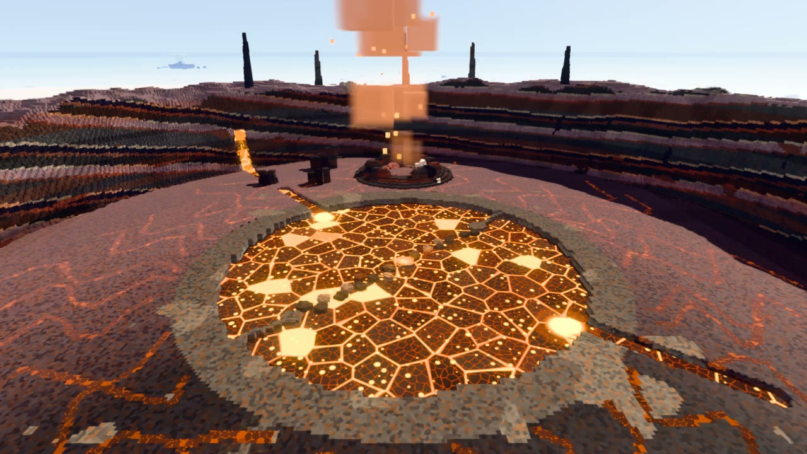
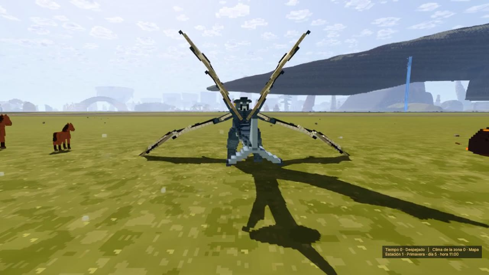
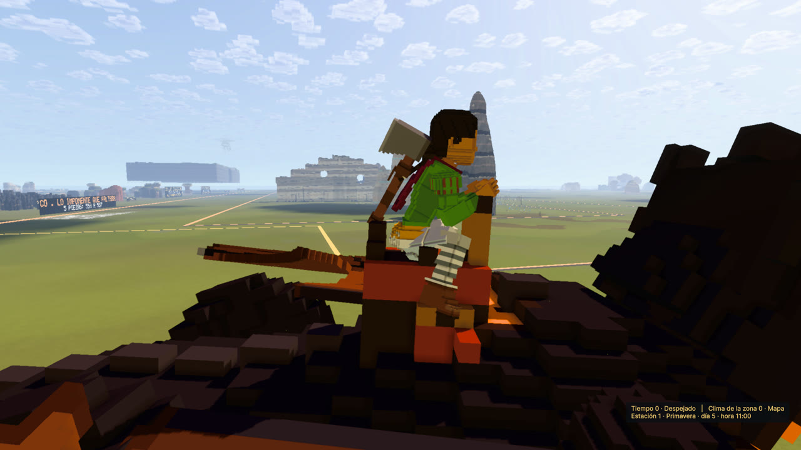
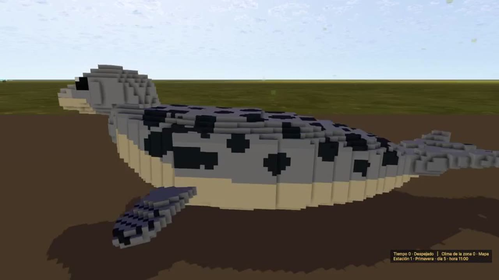

# Voxity

Un mundo gigante de vóxeles para recorrer a pie, a caballo y en dragón. Talás, picás, construís y descubrís pueblos, guaridas de dragones, volcanes e islas en el cielo.

## Cómo jugar (3 pasos)

1. **Bajá el lanzador:** [**VoxityLanzador.exe**](https://github.com/Sauri0/Voxity/releases/download/lanzador/VoxityLanzador.exe) (menos de 1 MB, con el ícono de la fogata).
2. **Abrilo.** La primera vez te pregunta en qué carpeta instalar, deja un acceso directo **Voxity** en el escritorio y te ofrece bajar el juego: unos 350 MB, una sola vez.
3. **Abrí siempre Voxity con ese acceso directo** y elegí:
   - **JUGAR:** el juego completo.
   - **PROBAR:** el mundo de pruebas, con todas las áreas para testear lo nuevo.

**El lanzador se encarga de todo:**
- cada vez que lo abrís, busca en GitHub si hay una versión nueva y te pregunta si querés actualizar;
- podés cambiar a otra versión;
- siempre queda **una sola versión instalada**: la anterior se borra, así no ocupa de más;
- también se actualiza a sí mismo.

> Windows defender puede avisar porque el lanzador es nuevo y no está firmado: tocá «Más información» → «Ejecutar de todas formas».

**Requisitos:** Windows 10 u 11 de 64 bits, una placa de video con DirectX 12 y unos 2 GB libres.

## Lo nuevo (v0.0.9.9.1)

| | |
|---|---|
|  | **La lava se ve desde arriba**: el lago de la caldera, las caídas y los surcos, de día y de noche, y los seis nidos de los dragones a la escala del dragón del mundo. |
|  | **Alas nuevas** con brazo, dedos y membrana pegada al cuerpo: se pliegan, se abren y baten. |
|  | **El jinete firme en la silla**, al galope y en el aire, sin temblar. |
|  | **Animales pulidos uno por uno**: articulaciones, giros con arco, reposos nuevos y poses de orilla. |

Además: los animales nacen fuera de la vista y en grupos sueltos con sus crías, el ala planea con física (la picada gana velocidad), el árbol que cae es el que estaba parado, el catalejo y las huellas del suelo. Es una versión de pulido: lo que sigue en pulido está en las notas del [release](https://github.com/Sauri0/Voxity/releases/tag/v0.0.9.9.1).

## Teclas

| Tecla | Qué hace |
|---|---|
| **W A S D** | Caminar |
| **Shift** | Correr |
| **Espacio** | Saltar; en el aire, abre el ala si la tenés equipada |
| **E** | Agarrar, sentarse, montar y bajar |
| **F** (mantener) | Trabajar: talar, picar, partir troncos |
| **T** (mantener) | Rueda de herramientas: elegís con el ratón |
| **G** (mantener) | Rueda de gestos |
| **X** | Llamar a tu caballo |
| **C** | Agacharse; en un dragón, bajar |
| **Alt + rueda del ratón** | Alejar o acercar la cámara cuando vas montado |
| **Tab** | Mochila (en Pruebas, también el creativo) |
| **Esc** | Menú; en Pruebas, el menú «Áreas de prueba» |

## El mundo de pruebas (PROBAR)

Ocho áreas para probar todo de cerca, a las que se llega desde **Esc → Áreas de prueba**:
1. personaje, talar y picar, y la torre del ala;
2. monturas: los caballos y los seis dragones;
3. animales en recintos y piletas;
4. todos los objetos del mapa;
5. megaestructuras, la Cumbre y el volcán;
6. modo creativo: construir y hacer aparecer animales y dragones;
7. agua, luz y sombras;
8. el pueblo y el reino.

## Versiones

Todas las versiones están en [Releases](https://github.com/Sauri0/Voxity/releases), y el lanzador las baja solo. Es una versión en desarrollo (pre-alfa): puede haber errores. Si encontrás algo, avisale a quien te pasó el link.
