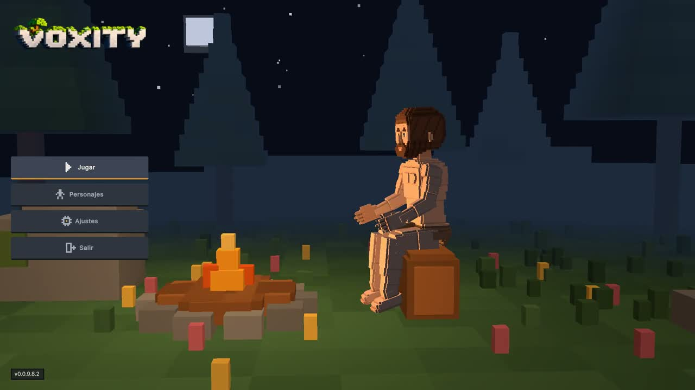

# Voxity

Un mundo gigante de vóxeles para recorrer a pie, a caballo y en dragón. Talás, picás, construís y descubrís pueblos, guaridas de dragones, volcanes e islas en el cielo.

## Cómo jugar

1. **Bajá el lanzador:** [VoxityLanzador.exe](https://github.com/Sauri0/Voxity/releases/download/lanzador/VoxityLanzador.exe) (1,5 MB, con el ícono de la fogata). Guardalo donde quieras: no se instala ni deja accesos directos.
2. **Abrilo** y tocá **INSTALAR**: baja el juego (unos 870 MB, una sola vez). Arriba a la derecha, **ENTRAR** abre el navegador para entrar o crear tu cuenta.
3. **JUGAR.** Cada vez que lo abrís busca la versión nueva y te ofrece actualizar.

> Windows puede avisar porque el lanzador no está firmado: «Más información» → «Ejecutar de todas formas».

## Con un amigo
1. Los dos con la **misma versión** (el lanzador te avisa si hay una nueva) y con su cuenta (ENTRAR en el lanzador).
2. En el juego: **Jugar con amigos → Tus amigos**. Pasale tu **código de amigo** (10 letras) o pegá el suyo en «Agregar»; el otro te acepta en «Te llegaron».
3. El que invita toca **Abrir mi partida**. El otro lo ve en Tus amigos «Con su partida» y toca **Unirme** (o pega el **código de la partida**, 8 letras, en «Unirme»).

**Requisitos:** Windows 10 u 11 de 64 bits, una placa de video con DirectX 11 y unos 2 GB libres.

## Lo nuevo (v0.2.7.4 · El clima y el hielo)

En la [v0.2.7.4](https://github.com/Sauri0/Voxity/releases/tag/v0.2.7.4):

- **El clima de cada lugar:** tormenta, lluvia, nieve, niebla, viento con rumbo y temperatura según la zona, la estación y la hora, igual en las dos PC. Con `/clima` el creador puede forzarlo.
- **Los lagos que se hielan:** en el invierno, 13 lagos se hielan de verdad: se pisan, el fino se agrieta y se raja bajo tus pies, y abajo el hielo es techo, con bolsas de aire para respirar.
- **Patinar y caer bajo el hielo:** el hielo resbala, frenás raspando con los pies, y si caés, salís por el agujero.
- **Pescar en el hielo:** abrís un agujero con el pico y pescás; el pez pelea bajo el hielo.
- **Los sonidos del clima y del hielo:** aguaceros, vendavales, truenos, el hielo que cruje y se raja.
- **Los nombres del agua:** al llegar a un río, un lago o el mar aparece su nombre.
- **El servidor aparte** guarda su mundo afuera de la versión, y el **lanzador 12** ya no se traba con un juego abierto en otra carpeta.

## Teclas

| Tecla | Qué hace |
|---|---|
| **W A S D** | Caminar |
| **Shift** | Correr |
| **Espacio** | Saltar; en el aire, abre el ala si la tenés equipada |
| **E** | Agarrar, sentarse, montar y bajar |
| **F** (mantener) | Trabajar: talar, picar, partir troncos |
| **T** (mantener) | Rueda de herramientas: elegís con el ratón |
| **G** (mantener) | Rueda de gestos |
| **X** | Llamar a tu caballo |
| **C** | Agacharse; en un dragón, bajar |
| **Alt + rueda del ratón** | Alejar o acercar la cámara cuando vas montado |
| **Tab** | Mochila (en Pruebas, también el creativo) |
| **Esc** | Menú; en Pruebas, el menú «Áreas de prueba» |

## El mundo de pruebas (PROBAR)

Once áreas para probar todo de cerca, a las que se llega desde **Esc → Áreas de prueba**:
1. personaje, talar y picar, y la torre del ala;
2. monturas: los caballos y los seis dragones;
3. animales en recintos y piletas;
4. todos los objetos del mapa;
5. megaestructuras, la Cumbre y el volcán;
6. modo creativo: construir y hacer aparecer animales y dragones;
7. agua, luz y sombras;
8. el pueblo y el reino;
9. las aguas para elegir;
10. la flora para elegir;
11. los animales para revisar.

## Versiones

- **v0.2.7.4** · El clima y el hielo (la última)
- v0.2.7.3 · La vida del agua, completa
- v0.2.7.2 · El agua, pulida
- v0.2.7.1 · El agua violeta
- v0.2.7 · La vida en el agua
- v0.2.6 · Lo que probaste, pulido
- v0.2.5 · La vida salvaje y los lugares especiales
- v0.2.4 · Los gráficos, la fluidez y lo que probaste
- v0.2.3 · El agua

Todas las versiones están en [Releases](https://github.com/Sauri0/Voxity/releases), y el lanzador las baja solo. Es una versión en desarrollo (pre-alfa): puede haber errores. Si encontrás algo, avisale a quien te pasó el link.
