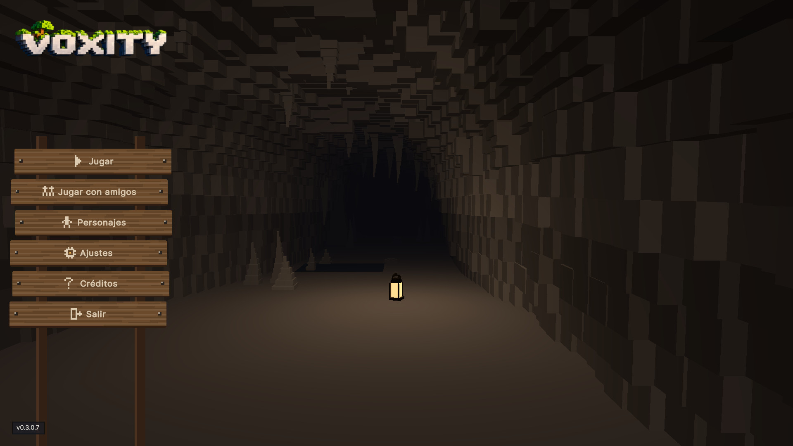
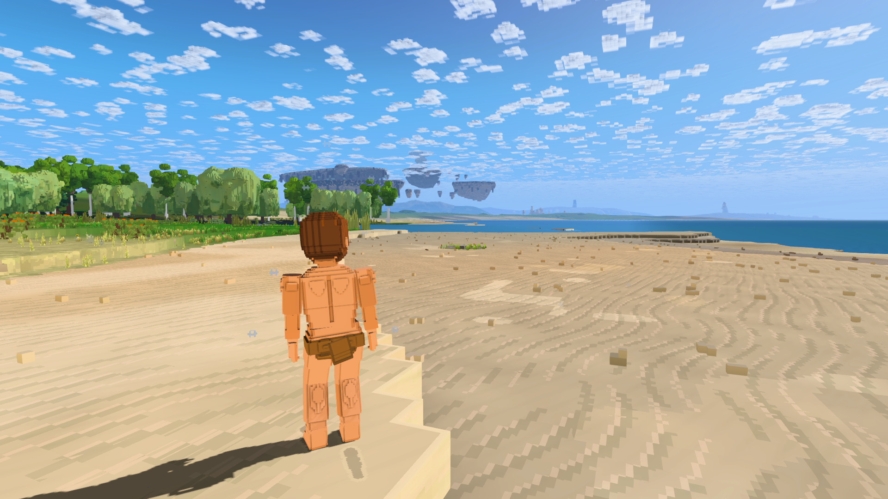
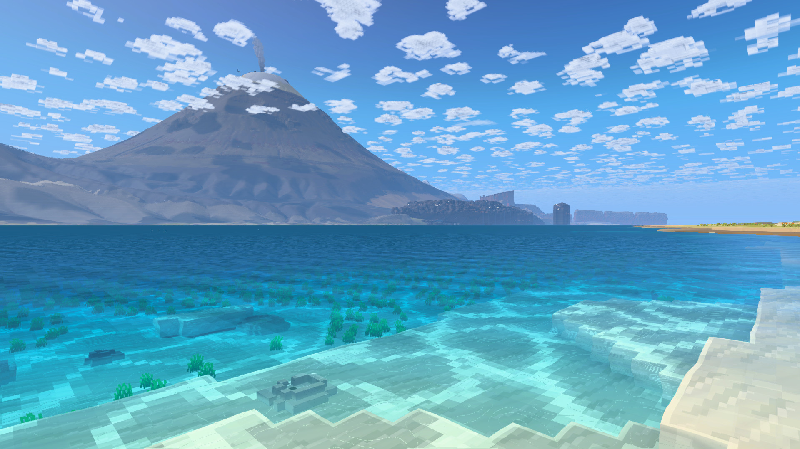
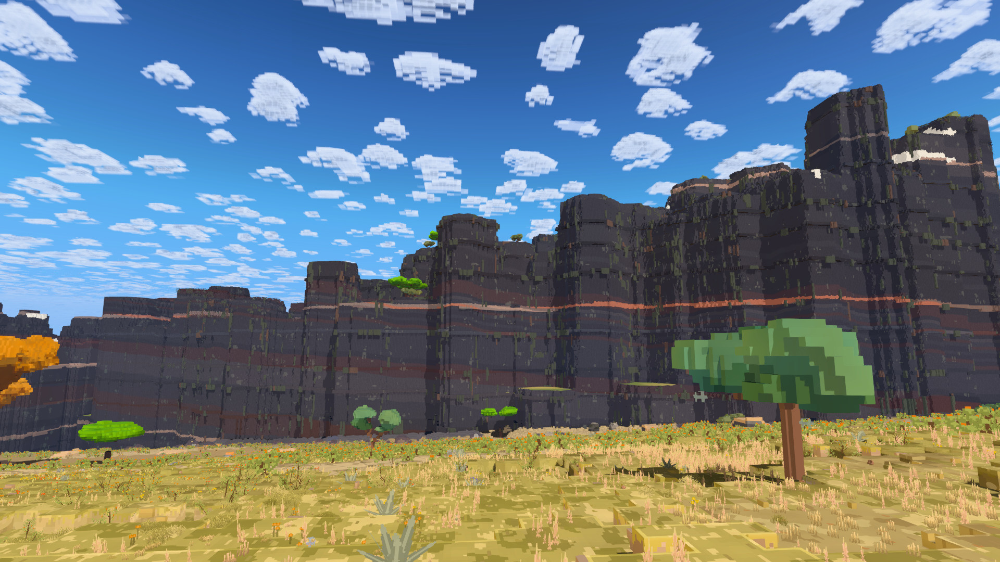
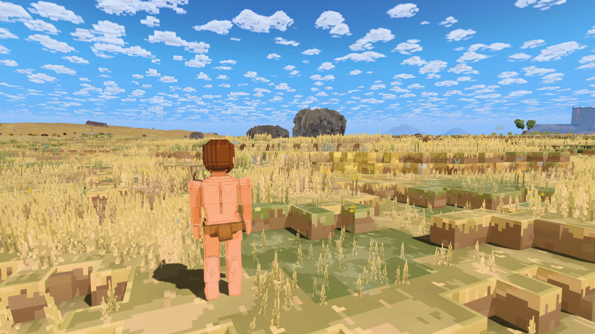
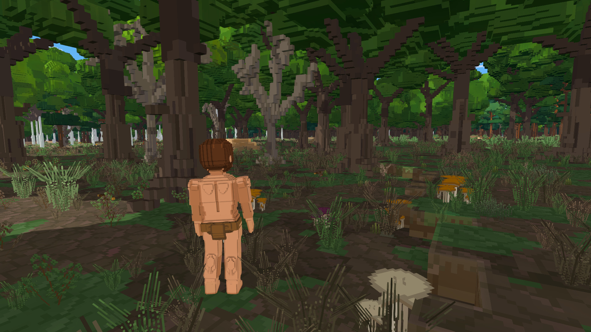

# Voxity

Un mundo grande de vóxeles para recorrer a pie. Llegás a la costa después de un naufragio, sin nada, y desde ahí juntás piedras y palos, armás tus primeras herramientas, prendés tu fogata y construís. La libreta te guía en la primera hora. Alrededor tenés la Catedral de Basalto, el volcán con sus ríos de lava, valles, estepas y bosques. El clima cambia según la zona y la hora, y los animales viven su día.

## Cómo jugar

1. **Bajá el lanzador:** [VoxityLanzador.exe](https://github.com/Sauri0/Voxity/releases/download/lanzador/VoxityLanzador.exe) (1,7 MB). Guardalo donde quieras: no se instala ni deja accesos directos.
2. **Abrilo** y tocá **INSTALAR**: baja la v0.3.1.1, una sola vez (un zip de 466 MB; instalado ocupa 1,3 GB).
3. **JUGAR.** Cada vez que lo abrís, busca si hay una versión nueva y te ofrece actualizar: la anterior se borra, pero tus partidas y tus ajustes quedan.

Para jugar no hace falta cuenta. Para jugar con amigos, sí: arriba, el botón **ENTRAR** abre el navegador para entrar o crear la tuya.

> Windows puede avisar porque el lanzador no está firmado: «Más información» → «Ejecutar de todas formas».

**Sin el lanzador:** bajá `Voxity_v0.3.1.1.zip` de la [última versión](https://github.com/Sauri0/Voxity/releases/latest), descomprimilo y abrí `Jugar_v0.3.1.1.cmd`. El mundo de pruebas se abre con `Pruebas_v0.3.1.1.cmd`.

**Lo que hace falta:** Windows 10 u 11 de 64 bits, una placa de video con DirectX 11 y unos 2 GB libres para instalar (después quedan 1,3 GB ocupados).

## Con un amigo

1. Los dos con la **misma versión** (el lanzador te avisa si hay una nueva) y con su cuenta (ENTRAR en el lanzador).
2. En el juego: **Jugar con amigos → Tus amigos**. Pasale tu **código de amigo** (10 letras) o pegá el suyo en «Agregar»; el otro te acepta en «Te llegaron».
3. El que invita toca **Abrir mi partida**. El otro lo ve en Tus amigos, «Con su partida», y toca **Unirme** (o pega el **código de la partida**, 8 letras, en «Unirme»).

La v0.3.1.1 sale sin el servidor aparte: se juega siempre desde la partida de uno de los dos.

## Lo nuevo (v0.3.1.1 · Pies y manos que apoyan)

- **Los pies apoyan:** al subir escalones el pie se apoya en cada pisada y la rodilla dobla hacia adelante; una escalera de tierra se sube sin saltar y sin que el pie flote ni se meta en el escalón.
- **Las manos al agua:** al tomar agua, las manos bajan al agua que tenés adelante.
- **Los restos y la carroña:** cuando un animal caza a otro, queda la osamenta de vóxeles, y los buitres bajan a comer sin asustar a nadie.
- **El olfato con el viento:** los animales te huelen más con el viento de vos hacia ellos y menos con el viento al revés.
- **Las briznas:** con fibra en la mano, la R suelta briznas que te muestran para dónde sopla el viento.
- **Las caras del bloque:** la tapa de cada bloque más clara y el costado más oscuro; se prueba en la fila «Caras».

Las notas completas, con lo medido y las fallas conocidas, están en la [v0.3.1.1](https://github.com/Sauri0/Voxity/releases/tag/v0.3.1.1). La anterior, la [v0.3.1.0](https://github.com/Sauri0/Voxity/releases/tag/v0.3.1.0), trajo el sol rosado, el canto de los bloques y las huellas de los animales.

## En camino

El camino que sigue se está replanteando: nuevas formas de hacer los modelos, las animaciones y los efectos, con captura de movimiento real, el cuerpo humano con anatomía, caminar y correr a velocidades reales, y los animales que se mueven y reaccionan como de verdad.

## La tanda v0.3.0: el mundo, rehecho zona por zona

El suelo de todo el mapa se está rehaciendo con un terreno nuevo, a la altura de las megaestructuras: escalones, lajas, cantos, cauces y la flora asentada encima. Lo publicado hasta hoy:

| Versión | Qué trajo |
|---|---|
| [v0.3.0.0](https://github.com/Sauri0/Voxity/releases/tag/v0.3.0.0) · La regla del terreno nuevo | La regla del suelo nuevo, probada en Pruebas contra la Catedral, y la bruma que asienta las megaestructuras en el paisaje |
| [v0.3.0.1](https://github.com/Sauri0/Voxity/releases/tag/v0.3.0.1) · La Catedral de Basalto y su suelo | Escalones, lajas y un talud de escombro al pie de la Catedral; tu personaje se acomoda si el suelo cambió donde estaba |
| [v0.3.0.2](https://github.com/Sauri0/Voxity/releases/tag/v0.3.0.2) · El volcán y sus ríos de lava | Los ríos de lava cavados en la ladera, con la costra y una vena viva encendida |
| [v0.3.0.5](https://github.com/Sauri0/Voxity/releases/tag/v0.3.0.5) · El noroeste | Las costas de llegada, el Valle, el Altiplano, el Bosque de Niebla, ocho regiones del noroeste y sus ríos con cauce |
| [v0.3.0.6](https://github.com/Sauri0/Voxity/releases/tag/v0.3.0.6) · El este y el centro | La Estepa, la Sabana y la Llanura del Norte; la hora dorada y la lluvia que no cae con sol |
| [v0.3.0.7](https://github.com/Sauri0/Voxity/releases/tag/v0.3.0.7) · La vida cotidiana | La lente y la libreta mojadas, los animales de día, el eco y el trueno |
| [v0.3.0.9](https://github.com/Sauri0/Voxity/releases/tag/v0.3.0.9) · Las islas, la bahía y el pulido | El sur, las bahías y las islas con el terreno nuevo; cada cara con su luz, el viento en el pasto y la ola que borra tus pasos |
| [v0.3.1.0](https://github.com/Sauri0/Voxity/releases/tag/v0.3.1.0) · El sol rosado | El sol que deja el limón, el canto claro de los bloques, las huellas y los pasos de los animales, y el Valle sin tirones |
| [v0.3.1.1](https://github.com/Sauri0/Voxity/releases/tag/v0.3.1.1) · Pies y manos que apoyan | Los pies que apoyan en el escalón, las manos al agua, la carroña, el olfato y las briznas del viento |

La v0.3.0.3 y la v0.3.0.4 no se publicaron por separado: lo suyo entró en la v0.3.0.5. Lo de la v0.3.0.8, «El sur», entró en la v0.3.0.9.

<table>
<tr>
<td></td>
<td></td>
</tr>
<tr>
<td align="center">La costa de la llegada, con las islas en el cielo</td>
<td align="center">El volcán, del otro lado de una laguna</td>
</tr>
<tr>
<td></td>
<td></td>
</tr>
<tr>
<td align="center">La Catedral de Basalto desde la pradera</td>
<td align="center">El pasto seco de la Estepa, entre bancales</td>
</tr>
<tr>
<td colspan="2"></td>
</tr>
<tr>
<td colspan="2" align="center">El bosque, con hongos y troncos caídos</td>
</tr>
</table>

## Teclas

Se cambian todas en el menú **F10**, panel **Teclas**.

| Tecla | Qué hace |
|---|---|
| **W A S D** | Caminar |
| **Shift** | Correr |
| **Alt** | Caminar despacio |
| **Ctrl** | Un impulso rápido hacia donde vas (doble Shift: esquivar) |
| **Espacio** | Saltar |
| **C** | Agacharse (mantener: pecho al piso) |
| **E** | Usar y agarrar lo que mirás: troncos, rocas, palos (mantener: todo lo cercano), sentarse, abrir |
| **F** (mantener) | Trabajar con la herramienta: talar, picar, partir un tronco. Con el catalejo en la mano, mirar por él (la rueda acerca) |
| **R** | Con el catalejo al ojo, limpiar la lente |
| **Clic izquierdo** | Pegar |
| **Clic derecho** o **Q** | Defenderse (tocar justo: parry). Con una piedra en la mano, mantener para apuntar y soltar para tirarla |
| **1 a 8** | Las casillas de la barra |
| **T** (mantener) | Rueda de herramientas |
| **G** (mantener) | Rueda de gestos |
| **B** | Construir con lo que llevás |
| **Y** | La libreta |
| **Tab** | La mochila |
| **I** | El bestiario |
| **Z** (mantener) | Cambiar carnada y aparejo, pescando |
| **X** | Llamar a tu caballo |
| **L** | Prender y apagar el farol |
| **N** | El mapa |
| **M** | El minimapa (Re Pág y Av Pág: acercar y alejar) |
| **K** | La brújula y las coordenadas |
| **F5** | Primera o tercera persona |
| **H** | Mostrar u ocultar la ayuda |
| **P** | El probador: el cuerpo, la cara, el pelo y la ropa |
| **Enter** | Saltear la llegada |
| **Esc** | Pausa (y cerrar un panel) |
| **F10** | Ajustes |

## El mundo de pruebas (Pruebas)

Veinte áreas para ver todo de cerca, a las que se llega desde la pausa, en **Áreas**:

1. Personaje, talar y picar · 2. Monturas: los caballos y los dragones · 3. Animales en recintos y piletas · 4. Los objetos del mapa · 5. Megaestructuras · 6. Modo creativo · 7. Agua, luz y sombras · 8. Pueblo y reino · 9. Aguas para elegir · 10. Flora para elegir · 11. Animales para revisar · 12. El cuerpo del otro · 13. La primera pelea · 14. A pescar · 15. Cazadores y manadas · 16. La vida en el agua · 17. Recintos · 18. El agua y el clima · 19. Las 5 versiones · 20. El terreno nuevo

En Pruebas, **Tab** abre también el creativo, y las teclas de **F2** a **F9** cambian la hora, el clima y la estación.

## Versiones

- **v0.3.1.1** · Pies y manos que apoyan (la última)
- v0.3.1.0 · El sol rosado
- v0.3.0.9 · Las islas, la bahía y el pulido (trae también la v0.3.0.8, El sur)
- v0.3.0.7 · La vida cotidiana
- v0.3.0.6 · El este y el centro
- v0.3.0.5 · El noroeste
- v0.3.0.2 · El volcán y sus ríos de lava
- v0.3.0.1 · La Catedral de Basalto y su suelo
- v0.3.0.0 · La regla del terreno nuevo
- v0.2.9.9 · La primera hora, pulida
- v0.2.9.2 · La libreta te guía
- v0.2.9.1 · Construir con la B
- v0.2.9.0 · Tu fogata
- v0.2.8.9 · La llegada, pulida, y el menú en la cueva

Todas, desde la v0.2.3, están en [Releases](https://github.com/Sauri0/Voxity/releases), y el lanzador baja la última solo. Es una versión en desarrollo (pre-alfa): puede haber errores. Si encontrás algo, avisale a quien te pasó el link.
